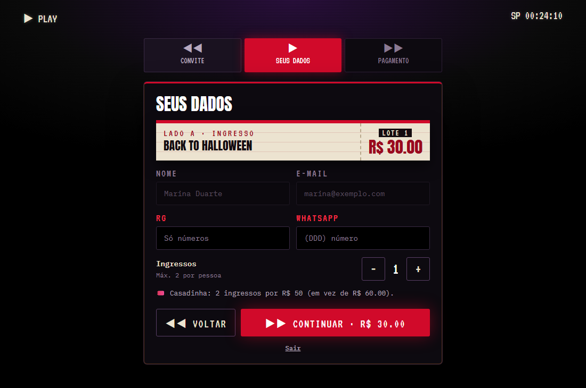
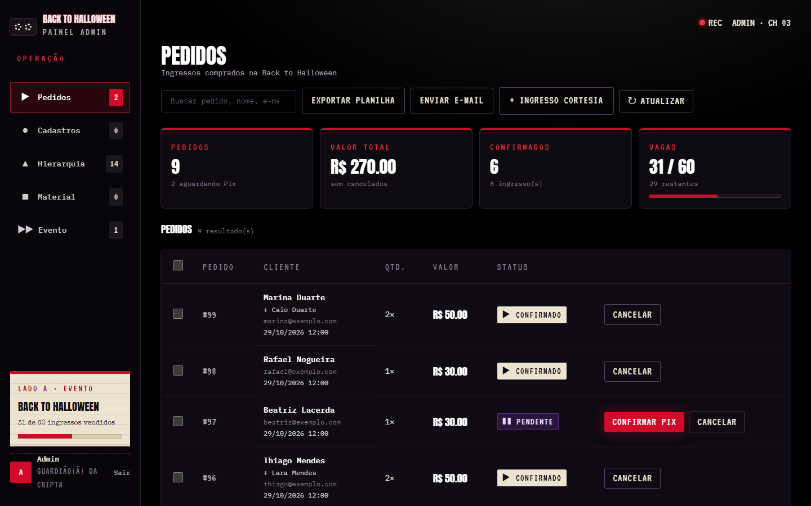
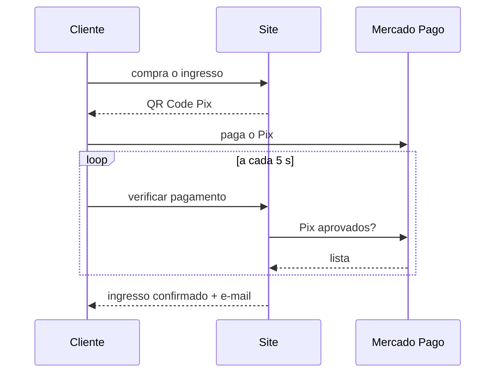
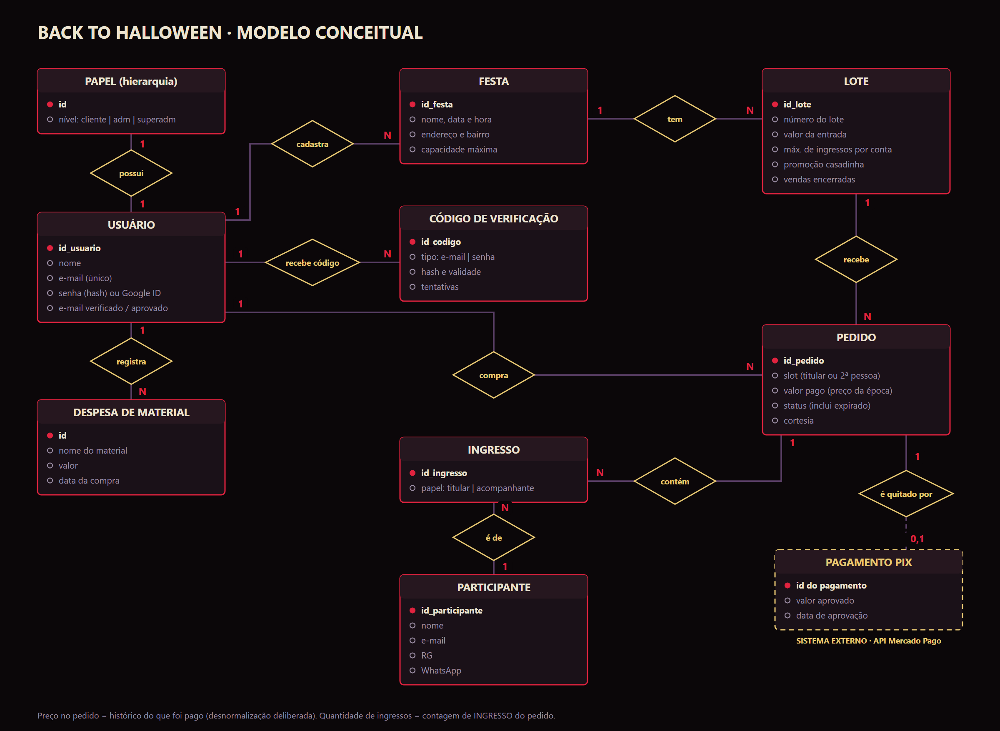
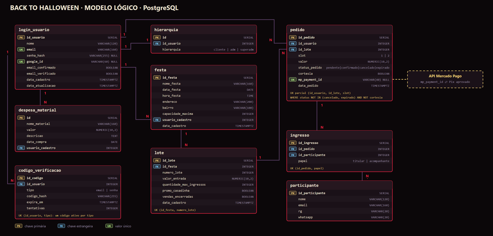

<div align="center">

# 🎃 Back to Halloween

**Convite, venda de ingressos por Pix e painel de portaria para festas pequenas e controladas.**

Cadastro com aprovação · Pix direto na chave, sem taxa de checkout · confirmação automática do pagamento · painel admin completo


</div>

---

## Por que existe

Vender ingresso de uma festa pequena costuma acabar em planilha, print de
comprovante e conferência manual. O Back to Halloween resolve isso de ponta a
ponta: a pessoa se cadastra, o organizador aprova, ela paga um Pix e o sistema
**confirma sozinho**, controla as vagas e entrega a lista de quem entra.

Foi usado em produção para vender os ingressos da festa de Halloween que deu
nome ao projeto. O código fica aqui como vitrine de uma aplicação web completa,
do banco ao visual.

## O que entrega

| Para quem vai à festa | Para quem organiza |
|---|---|
| Cadastro por e-mail e senha (com código de 6 dígitos) ou conta Google | Aprovação de cada cadastro antes de liberar a compra |
| Compra em poucos toques, com promoção "casadinha" (2 ingressos por um valor fechado) | Pedidos com confirmação, cancelamento e ações em lote |
| Pix por QR Code ou "copia e cola", com contagem regressiva de 5 minutos | **Confirmação automática** do Pix pela API do Mercado Pago |
| Ingresso em formato de fita VHS, também por e-mail | Controle de vagas e de lotes (preço por lote, liga/desliga da promoção) |
| Histórico em "Meus pedidos" | Ingressos de cortesia, e-mail em massa e planilha `.xlsx` para a portaria |
| Visual retrô anos 80/90/2000 em todas as telas | Hierarquia de usuários (cliente, admin, superadmin) e despesas de material |

## Telas

<table>
<tr>
<td width="50%"><br><sub><b>Compra</b>: dados, quantidade e promoção casadinha</sub></td>
<td width="50%"><br><sub><b>Painel admin</b>: pedidos, vagas e confirmação (dados fictícios)</sub></td>
</tr>
</table>

## Como o pagamento funciona

O Pix cai **direto na chave** do organizador, sem o Checkout (que cobra ~1%). Como
não existe pedido no Mercado Pago, o sistema consulta a API de Pagamentos,
encontra o Pix aprovado com o mesmo valor depois da criação do pedido e
confirma. Um índice único no banco garante que **o mesmo pagamento nunca
confirma dois pedidos**, e uma falha da API **nunca cancela** o pedido de quem
já pagou.



Detalhes, regras e limites conhecidos em [`docs/ARQUITETURA.md`](docs/ARQUITETURA.md).

## Integrações

| Serviço | Uso |
|---|---|
| **Mercado Pago** (API de Pagamentos) | Conciliação dos Pix pagos direto na chave: busca paginada, cache curto, timeout e pausa após falha |
| **Brevo** (e-mail transacional) | Códigos de verificação, ingresso confirmado e avisos aos admins, enviados em segundo plano |
| **Google OAuth** | Login com Google (Authlib) |

## Modelo de dados

Normalizado até a **3FN**, em PostgreSQL (`app/schema.sql`): 9 tabelas e 2 views de leitura.

| Tabela | O que guarda |
|---|---|
| `login_usuario`, `hierarquia` | Contas e papéis (cliente, admin, superadmin) |
| `codigo_verificacao` | Códigos de 6 dígitos (e-mail e "esqueci a senha"), uma linha por código ativo |
| `festa` | O evento: nome, data, hora, endereço e capacidade |
| `lote` | Preço, promoção casadinha e liga/desliga das vendas (o lote mais recente está à venda) |
| `pedido` | Quem comprou, qual lote, quanto pagou, status e o Pix que o quitou |
| `ingresso`, `participante` | Uma linha por pessoa que vai à festa (titular ou acompanhante) com nome, e-mail, RG e WhatsApp |
| `despesa_material` | Despesas do evento |

As regras críticas moram no banco:

- `SELECT ... FOR UPDATE` na festa: duas compras simultâneas não passam da capacidade;
- índice único parcial `(id_usuario, id_lote, slot)`: sem pedido duplicado por duplo clique;
- índice único parcial em `mp_payment_id`: um pagamento, um pedido;
- `UNIQUE (id_pedido, papel)`: no máximo um titular e um acompanhante por pedido;
- trigger que apaga o participante que ficou sem ingresso.

`v_evento` e `v_pedido` são views **só de leitura** que juntam as tabelas no formato que as telas, os e-mails e a planilha consomem; as escritas vão direto nas tabelas. Uma decisão de projeto: `pedido.valor` guarda o **preço pago na época** (histórico, não cálculo), então não se recalcula a partir do lote.

| Modelo conceitual | Modelo lógico |
|---|---|
|  |  |

### Banco que já existia (versão anterior)

O banco da versão anterior (tabela `evento`, pedido com colunas do titular e do acompanhante) é convertido **sem perder dados** por [`app/migracao_3fn.sql`](app/migracao_3fn.sql), numa transação só. Faça um backup, rode a migração **antes** de subir o código novo (os dois não funcionam juntos) e confira o resultado:

```bash
psql "$DATABASE_URL" -f app/migracao_3fn.sql
```

A migração é testada contra um PostgreSQL de verdade: os pedidos continuam idênticos na view e a estrutura migrada é igual à de um banco criado só com o `schema.sql`.

## Segurança e desempenho

- Senhas com scrypt; códigos de 6 dígitos com tentativas reservadas de forma
  atômica no banco; limite de requisições por IP nos endpoints sensíveis.
- Cookies `SameSite=Lax`, checagem de `Origin` em POST, cabeçalhos de segurança,
  proteção contra open redirect e sessões revogadas ao trocar a senha.
- Pool de conexões, cache de 1 ano nos estáticos (URL com hash de conteúdo) e
  fontes hospedadas no próprio site.

## Começando

Pré-requisitos: Python 3.12 e um PostgreSQL.

```bash
pip install -r requirements.txt
psql "$DATABASE_URL" -f app/schema.sql     # cria as tabelas (banco novo)
cp .env.example .env                        # preencha os valores
cd app && python app.py                     # http://127.0.0.1:5000
```

Sem as credenciais do Google e do Brevo o site sobe, mas o login completo não
funciona. Para criar o primeiro admin: `python app/tornar_admin.py email@exemplo.com`
(nenhuma rota HTTP faz isso, de propósito).

### Configuração

Todas as variáveis estão comentadas em [`.env.example`](.env.example).

| Variável | Para quê |
|---|---|
| `DATABASE_URL` | Conexão com o PostgreSQL |
| `SECRET_KEY` | Assinatura da sessão do Flask |
| `GOOGLE_CLIENT_ID` / `GOOGLE_CLIENT_SECRET` | Login com Google |
| `BREVO_API_KEY` / `BREVO_FROM_EMAIL` / `BREVO_FROM_NOME` | E-mails transacionais |
| `PIX_KEY_30` / `PIX_KEY_50` / `PIX_KEY_60` | Chave Pix de cada valor de pedido |
| `MERCADOPAGO_ACCESS_TOKEN` | Consulta dos Pix aprovados |
| `BASE_URL` | URL pública do site (links dos e-mails) |
| `DB_POOL_MAX` | Opcional: conexões por processo (padrão 5) |

### Testes

```bash
pip install -r requirements-dev.txt
python tests/run_all.py
```

338 verificações em 11 suítes. Nove usam banco simulado (e Mercado Pago, Brevo e Google
simulados): conciliação do Pix, limites de vagas e de conta, segurança dos códigos de
login, falhas de integração, desempenho do cache e do pool. Duas usam um **PostgreSQL de
verdade** (embarcado, via `pgserver`, sem instalar nada): a migração para a 3FN e o
**fluxo completo do site**, de cadastro e compra até Pix, expiração, painel admin e
redefinição de senha, conferindo o que fica em cada tabela. Sem o `pgserver`, essas duas
são puladas.

### Deploy

O [`render.yaml`](render.yaml) descreve o Web Service no Render. As variáveis
`sync: false` (segredos) são preenchidas à mão no painel. O Start Command deve
ser igual ao do arquivo:

```
cd app && gunicorn app:app --workers 2 --threads 4 --timeout 30
```

## Estrutura

```
app/
  app.py            # app Flask, rotas públicas, cabeçalhos e cache
  auth.py           # cadastro, login, códigos, Google OAuth
  pedidos.py        # compra, Pix e conciliação com o Mercado Pago
  admin.py          # painel administrativo
  email_utils.py    # e-mails (Brevo)
  limitador.py      # limite de requisições por IP
  db.py             # pool de conexões Postgres
  config.py         # variáveis de ambiente
  schema.sql        # schema do banco (3FN)
  migracao_3fn.sql  # converte um banco da versão anterior
  templates/        # páginas (Jinja)
  static/           # CSS, JS, fontes e imagens
docs/               # arquitetura e imagens (telas e modelos de dados)
tests/              # suítes de teste e runner (run_all.py)
render.yaml         # deploy no Render
```

## Documentação

- [Arquitetura](docs/ARQUITETURA.md): fluxo do Pix, regras no banco, segurança e limites conhecidos
- [Histórico de mudanças](CHANGELOG.md)

## Próximos passos (se o projeto continuasse)

- Webhook do Mercado Pago, para confirmar o Pix mesmo com a aba fechada.
- Limitador de requisições com armazenamento compartilhado (Redis) para várias instâncias.
- Painel de portaria com leitura de QR Code no check-in.

## Licença

Todos os direitos reservados. Nenhuma licença de código aberto foi concedida.
