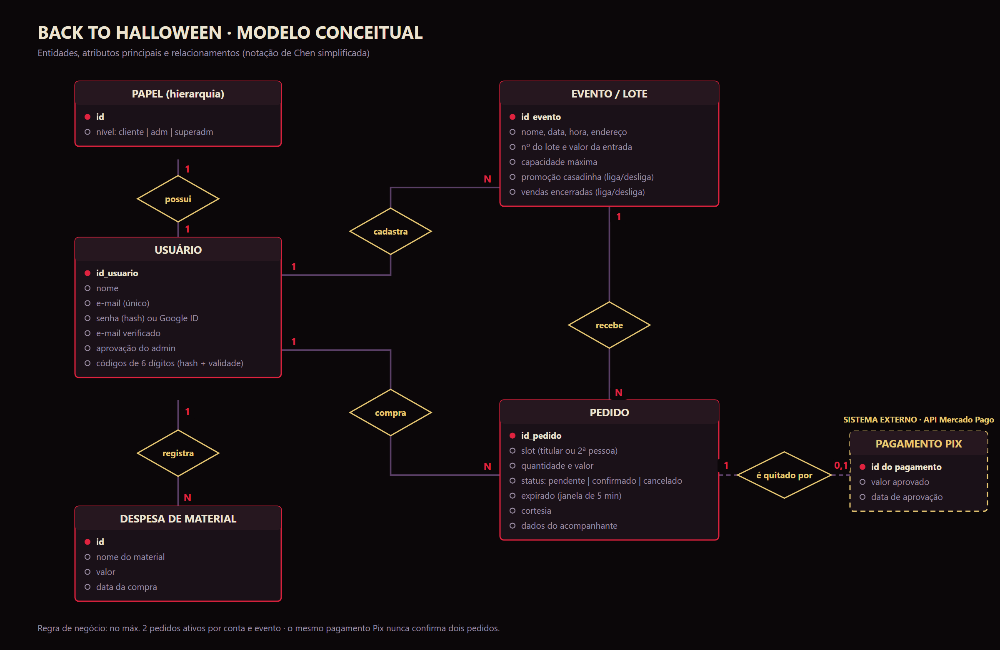
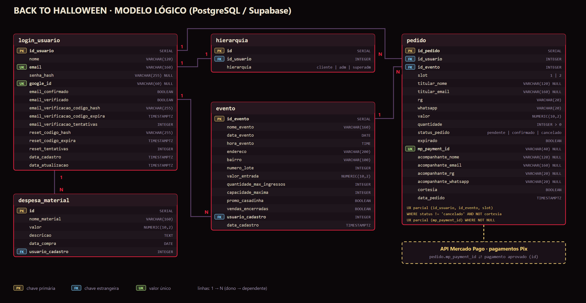

# Back to Halloween

Site de convite e venda de ingressos de uma festa de Halloween com tema de
terror dos anos 80/90/2000. Projeto pessoal, feito de ponta a ponta: front-end,
back-end, banco de dados, pagamento por Pix e painel administrativo.


> Projeto encerrado. A festa aconteceu e o código fica aqui como registro.

## O que ele faz

- **Cadastro e login** por e-mail e senha (com código de 6 dígitos enviado por
  e-mail) ou por conta Google (OAuth). Cada cadastro é aprovado por um admin
  antes de a pessoa poder comprar.
- **Compra de ingresso** com pagamento por **Pix direto na chave** (sem taxa de
  checkout). Até 2 pedidos por conta e evento (o titular e uma segunda pessoa),
  com promoção "casadinha" (2 ingressos por um valor fechado) que o admin liga
  e desliga.
- **Confirmação automática do pagamento**: o sistema consulta a API de
  Pagamentos do Mercado Pago, encontra o Pix aprovado do mesmo valor depois da
  criação do pedido e confirma. O mesmo pagamento nunca confirma dois pedidos
  (índice único parcial no banco).
- **E-mails transacionais** pela API do Brevo: código de verificação,
  ingresso confirmado, avisos para os admins.
- **Painel admin**: pedidos (confirmar, cancelar, ações em lote, cortesias),
  cadastros pendentes, hierarquia de usuários, lotes e capacidade do evento,
  despesas de material e planilha `.xlsx` para a portaria.

## Integrações (APIs)

| Serviço | Para quê | Como |
|---|---|---|
| Mercado Pago (API de Pagamentos) | Conciliar Pix pagos direto na chave | Busca paginada de pagamentos aprovados, cache curto, timeout e pausa após falha. Se a API falhar, o pedido **não** expira |
| Brevo (e-mail transacional) | Códigos e confirmações | Chamada HTTP, em segundo plano para não segurar a conexão do banco |
| Google OAuth | Login com Google | Authlib |
| Pix "copia e cola" | QR Code do pagamento | Payload gerado localmente (`app/pix_copia_cola.py`) |

## Modelo de dados

Cinco tabelas em PostgreSQL (`app/schema.sql`): `login_usuario`, `hierarquia`,
`evento` (cada linha é um lote), `pedido` e `despesa_material`.

| Modelo conceitual | Modelo lógico |
|---|---|
|  |  |

Pontos de atenção do desenho:

- **Índice único parcial** `(id_usuario, id_evento, slot)` para pedidos ativos
  não cortesia: impede pedido duplicado por duplo clique ou duas abas.
- **Índice único parcial** em `pedido.mp_payment_id`: um pagamento real nunca é
  contado duas vezes.
- **`FOR UPDATE` no evento** na hora de comprar: duas pessoas não passam da
  capacidade ao mesmo tempo.
- `pedido.valor` guarda o **preço pago na época** (histórico), de propósito.

### Normalização

O modelo acima é pragmático e **não está em 3FN**: `evento` mistura dados da
festa e do lote, e `pedido` guarda os dados das duas pessoas (titular e
acompanhante). Uma proposta normalizada (`festa`, `lote`, `participante`,
`ingresso`, `codigo_verificacao`) está desenhada em `docs/`, mas **não foi
implementada**:
[conceitual](docs/proposta-3fn-conceitual.png) ·
[lógico](docs/proposta-3fn-logico.png).

## Stack

Python 3.12, Flask 3.1, PostgreSQL (Supabase), psycopg2 com pool de conexões,
gunicorn, Authlib, openpyxl, Pillow/qrcode. HTML, CSS e JavaScript puros (sem
framework no front). Deploy no Render.

## Segurança e desempenho

- Limite de requisições por IP nos endpoints sensíveis (login, cadastro,
  códigos), em memória.
- Códigos de 6 dígitos com tentativas reservadas de forma atômica no banco e
  hash próprio; senhas com scrypt.
- Cookies `SameSite=Lax`, checagem de `Origin` em POST, cabeçalhos de segurança,
  redirecionamento pós-login validado contra open redirect, sessões revogadas ao
  trocar a senha.
- Pool de conexões, cache longo dos arquivos estáticos (URL com hash) e fontes
  hospedadas no próprio site.

## Rodando localmente

1. `pip install -r requirements.txt`
2. Suba um Postgres local e aplique o schema: `psql "$DATABASE_URL" -f app/schema.sql`
3. Copie `.env.example` para `.env` e preencha os valores (os comentários do
   arquivo explicam cada um). Sem as credenciais do Google e do Brevo o site
   sobe, mas o login completo não funciona.
4. `cd app && python app.py` e abra http://127.0.0.1:5000

Para virar admin pela primeira vez, use `python app/tornar_admin.py email@exemplo.com`
(nenhuma rota HTTP faz isso, de propósito).

## Deploy (Render)

O `render.yaml` define o Web Service. As variáveis marcadas `sync: false`
(banco, Google, Brevo, chaves Pix, token do Mercado Pago, `BASE_URL`) são
preenchidas à mão no painel do Render, por serem segredos. O Start Command do
painel deve ser igual ao do `render.yaml`:

```
cd app && gunicorn app:app --workers 2 --threads 4 --timeout 30
```

## Estrutura

```
app/
  app.py            # app Flask, rotas públicas, cabeçalhos e cache
  auth.py           # cadastro, login, códigos, Google OAuth
  pedidos.py        # compra, Pix e conciliação com o Mercado Pago
  admin.py          # painel administrativo
  email_utils.py    # e-mails (Brevo)
  limitador.py      # limite de requisições por IP
  db.py             # pool de conexões Postgres
  config.py         # variáveis de ambiente
  schema.sql        # schema do banco
  templates/        # páginas (Jinja)
  static/           # CSS, JS, fontes e imagens
docs/               # imagens: tela inicial e modelos de dados
```
