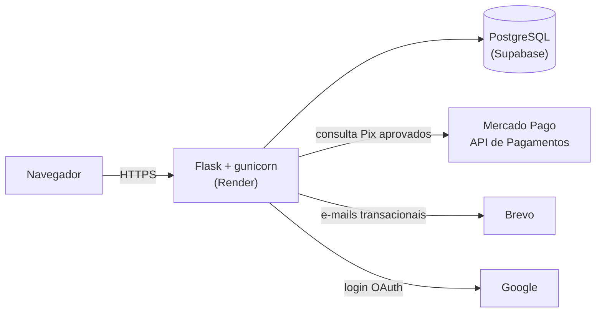
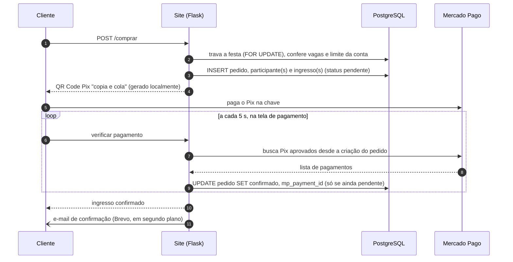
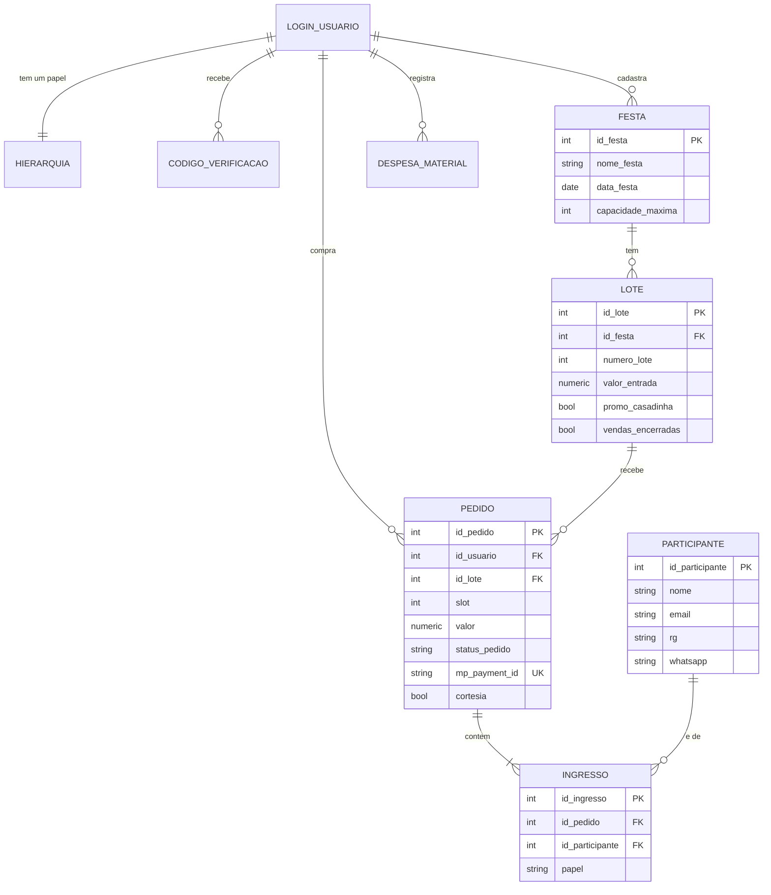

# Arquitetura

Visão técnica do Back to Halloween: como as peças se conectam, como o Pix é
conciliado, as regras que ficam no banco de dados e os limites conhecidos.

## Visão geral

- Uma aplicação Flask (renderização no servidor com Jinja) servida por gunicorn
  (2 processos × 4 threads).
- Banco PostgreSQL com pool de conexões por processo (`app/db.py`).
- Nada de framework de front-end: HTML, CSS e JavaScript puros, com o tema VHS
  feito à mão.
- Integrações externas sempre atrás de timeout e tratamento de falha; envio de
  e-mail em segundo plano para não segurar a conexão do banco.

## Fluxo de compra e pagamento por Pix

O Pix é pago **direto na chave**, sem o Checkout do Mercado Pago (sem a taxa de
~1%). Como não existe um pedido criado no Mercado Pago, o sistema descobre o
pagamento consultando a API de Pagamentos.

### Regras da conciliação (`app/pedidos.py`)

Um Pix só confirma um pedido se **todas** as condições forem verdadeiras:

1. status `approved` e método `pix`;
2. valor idêntico ao do pedido;
3. aprovado depois da criação do pedido (com 30 s de folga);
4. ainda não usado por nenhum outro pedido.

Proteções:

- **Um pagamento, um pedido.** Índice único parcial em `pedido.mp_payment_id`.
  Se dois pedidos do mesmo valor disputarem o mesmo Pix, o segundo recebe
  `UniqueViolation`, não confirma nada e tenta de novo no ciclo seguinte.
- **Confirmação atômica.** O `UPDATE` só vale se `status_pedido = 'pendente'`
  (confere `rowcount`, nunca assume).
- **Falha da API não pune o cliente.** Se o Mercado Pago não responde, o pedido
  **não** expira: a expiração só é decidida com uma consulta bem-sucedida (e sem
  usar o cache curto de 3 s).
- **Resiliência.** Timeout de 6 s, pausa de 10 s depois de uma falha, busca
  paginada (até 3 páginas de 100) filtrada por `status=approved` e Pix.
- **Janela de pagamento de 5 minutos.** Pedido pendente além disso passa para o
  status `expirado`, liberando a vaga.

## Regras que moram no banco

Regra importante não depende só do código da aplicação:

| Regra | Como é garantida |
|---|---|
| Não passar da capacidade da festa | `SELECT ... FOR UPDATE` na linha da `festa`, dentro da transação de compra |
| No máximo 2 pedidos ativos por conta e lote | Índice único parcial `(id_usuario, id_lote, slot)` onde o pedido não está cancelado/expirado e não é cortesia |
| Um pagamento nunca confirma 2 pedidos | Índice único parcial em `mp_payment_id` |
| Um pedido tem no máximo 1 titular e 1 acompanhante | `UNIQUE (id_pedido, papel)` em `ingresso` |
| Nenhum participante solto | Trigger apaga o participante que ficou sem ingresso (inclusive quando o pedido é apagado em cascata) |
| Um código ativo por tipo e por conta | `UNIQUE (id_usuario, tipo)` em `codigo_verificacao` |
| Papel e status válidos | `CHECK` em `hierarquia` e em `pedido.status_pedido` (`pendente`, `confirmado`, `cancelado`, `expirado`) |
| E-mail e Google ID únicos | `UNIQUE` |

## Modelo de dados

Normalizado até a 3FN: 9 tabelas e 2 views de leitura.

Diagramas completos (conceitual e lógico) em [`img/`](img).

**Decisões de projeto**

- `festa` guarda o que vale para o evento inteiro (nome, data, endereço, capacidade) e
  `lote` guarda o que muda com o preço. Antes isso era uma tabela só, e o código tinha
  que copiar os dados a cada lote novo.
- Quem vai à festa é um `participante`, ligado ao pedido por um `ingresso`. A quantidade
  de ingressos de um pedido é a contagem de linhas em `ingresso`, não uma coluna.
- `pedido.valor` guarda o preço pago na época (histórico), de propósito: é a única
  informação que não se recalcula a partir do lote.
- `expirado` é um status do pedido, não um booleano à parte.
- `v_evento` (lote + festa) e `v_pedido` (pedido + titular + acompanhante) são **views
  de leitura**. As telas, os e-mails e a planilha leem delas; as escritas vão nas
  tabelas. Para o pedido expirado, a view mostra `cancelado` com `expirado = TRUE`, como
  as telas sempre enxergaram.

**Migração.** Um banco da versão anterior é convertido por `app/migracao_3fn.sql`, numa
transação, sem perder dados. O teste `tests/test_migracao_3fn.py` cria o banco no formato
antigo, grava dados variados, migra e confere que os pedidos continuam iguais na view e
que a estrutura é idêntica à de um banco criado só com `schema.sql`.

## Segurança

- **Autenticação:** senha com scrypt; login com Google via OAuth (Authlib).
  Códigos de 6 dígitos com hash próprio (scrypt leve, o código tem validade
  curta) e tentativas **reservadas de forma atômica** (`UPDATE ... RETURNING`
  antes de conferir), então requisições concorrentes não burlam o limite.
- **Sessão:** cookies `SameSite=Lax`, versão de sessão ligada à troca de senha
  (trocar a senha derruba as outras sessões).
- **CSRF:** conferência do cabeçalho `Origin` em requisições POST.
- **Limite de requisições** por IP nos endpoints sensíveis (`app/limitador.py`).
- **Redirecionamento pós-login** validado contra open redirect (`_next_seguro`).
- **Cabeçalhos:** `X-Content-Type-Options`, `X-Frame-Options: DENY`,
  `frame-ancestors 'none'`, `Referrer-Policy`, HSTS em HTTPS.
- **Admin:** rotas protegidas por papel; o `superadm` não pode ser rebaixado nem
  apagado pela interface.

## Desempenho

- Pool de conexões com teste de conexão ociosa e espera por vaga em vez de abrir
  conexão nova a cada pico.
- Arquivos estáticos com `?v=<hash do conteúdo>` e cache de 1 ano (`immutable`),
  só em respostas 200/206/304.
- Fontes hospedadas no próprio site (sem requisição a terceiros).
- Menos consultas por página: usuário atual em cache por requisição e contadores
  do menu admin em uma consulta só.

## Limites conhecidos

- **Conciliação por valor.** O Pix direto não identifica o pagador. Dois Pix de
  mesmo valor aprovados na mesma janela podem se confundir entre pedidos
  diferentes (o índice único evita contar o mesmo pagamento duas vezes, mas não
  sabe a quem ele pertence). O admin pode confirmar ou cancelar manualmente.
- **Limitador em memória.** Cada processo do gunicorn tem o próprio contador, e
  ele zera quando o serviço reinicia. Para mais de uma instância, usar um
  armazenamento compartilhado (por exemplo, Redis).
- **Sem webhook.** A confirmação depende de a tela de pagamento estar aberta
  consultando o servidor; um webhook do Mercado Pago confirmaria mesmo com a aba
  fechada.
